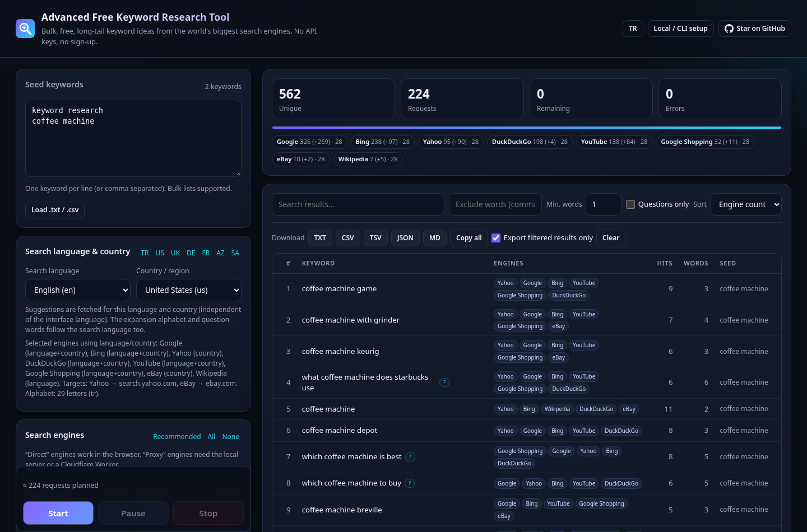

<div align="center">


# Advanced Free Keyword Research Tool

**Bulk long-tail keyword ideas from 25 search engines' autocomplete — free, open source, no API keys.**

Google · Bing · YouTube · Yahoo · DuckDuckGo · Yandex · Baidu · Naver · Amazon · eBay · Walmart · TikTok · Wikipedia · Ecosia · Qwant · Brave · Seznam · 360 · Sogou · Quark · Swisscows · Google Images / News / Shopping / Scholar

[**▶ Open the web app**](https://cumabozkurt.github.io/advanced-free-keyword-research-tool/) · [Türkçe](README.tr.md) · [Research](RESEARCH.md) · [Endpoints](docs/ENDPOINTS.md) · [Audit](docs/AUDIT.md)



</div>

## Features

- **25 engines** (14 work directly in the browser on GitHub Pages, all 25 via CLI / local server / GitHub Action)
- **Bulk input** — paste hundreds of seeds, or load a `.txt` / `.csv`
- **Long-tail expansion** — alphabet suffix/prefix (locale-aware: Turkish `ç ğ ı ö ş ü`, German, Spanish, Russian…), digits, question words, modifiers (`for, best, price, near me…`), your own prefixes/suffixes
- **Recursive mining** with depth control; new suggestions are cross-checked on *all* selected engines
- **De-duplicated results** with an *engine agreement* score (how many engines suggested the phrase), hits, word count, question flag, source seed
- **Filter & sort** — search, exclude words, min. words, questions only
- **Exports** — TXT, CSV (UTF-8 BOM for Excel, formula-injection safe), TSV, JSON, Markdown, copy to clipboard
- **Polite by design** — per-engine delay, concurrency limit, max requests, pause / resume / stop, auto-disable failing engines
- **Search language & country** (default 🇹🇷 `tr` / `tr`) wired into every engine that supports it — see [Language & country](#language--country)
- **Turkish & English UI**, dark theme, keyboard accessible, mobile friendly, settings saved locally
- **Zero dependencies, no build step** — plain ES modules shared by browser and Node

## Ways to use it

### 1. In the browser (GitHub Pages)

Open **https://cumabozkurt.github.io/advanced-free-keyword-research-tool/**, type keywords, pick engines, press **Start**.
Engines marked **Direct** work immediately. Engines marked **Proxy** (Amazon, Yandex, Brave, Ecosia, Qwant, Walmart, TikTok, …)
need a proxy — see options 2 or 4.

Shareable links: `…/?q=seo+tools&engines=google,bing,youtube&hl=en&gl=us&run=1`

### 2. Local server — all engines in the browser

```bash
git clone https://github.com/cumabozkurt/advanced-free-keyword-research-tool
cd advanced-free-keyword-research-tool
npm start            # → http://localhost:8787  (Node 18+, nothing to install)
```

The app detects the built-in proxy automatically and unlocks every engine.

### 3. Command line

```bash
node bin/cli.js "kahve makinesi"                              # defaults: Turkish / Türkiye → stdout
node bin/cli.js "seo tools" -l en -c us                       # English / United States
node bin/cli.js -f seeds.txt -e all -x alpha,questions -d 1 -l de -c de -o out.csv -o out.txt
node bin/cli.js "kahve makinesi" -e google,yandex,amazon,youtube -o kahve.json   # amazon.com.tr
cat seeds.txt | node bin/cli.js -e web -x none --format tsv > out.tsv
node bin/cli.js --list-engines
node bin/cli.js --help
```

(Or `npm i -g .` once, then use `afkrt …`.)

### 4. On GitHub itself — no computer needed

Fork the repo → **Actions** → **Mine keywords** → **Run workflow**, fill in keywords/engines → download the `keywords` artifact (TXT/CSV/TSV/JSON).
The first 100 results are shown in the run summary.

### 5. Public proxy for your Pages site (optional)

```bash
cd proxy && npx wrangler deploy      # Cloudflare Workers free tier
```

Paste the worker URL into **Options → Proxy URL** in the app. Set `ALLOWED_ORIGINS` in `proxy/wrangler.toml` to your Pages origin.

You can also point the Pages app at your **local** server (`http://localhost:8787`). By default the local server only accepts
cross-origin calls from `https://cumabozkurt.github.io`; for a fork use `npm start -- --allow-origin https://<you>.github.io`.

## Language & country

Suggestions differ a lot per market, so every search has a **search language** (`hl`) and **country/region** (`gl`),
independent of the interface language. Default: **Turkish / Türkiye** (`tr` / `tr`).

- **Web app:** *Search language & country* card with ~38 languages, ~60 countries and quick presets (TR, US, UK, DE, FR, AZ, SA). A live line shows which selected engines use the locale and where they point (e.g. `Amazon → amazon.com.tr`). Shareable via `?hl=tr&gl=tr`.
- **CLI:** `-l/--lang <hl>` and `-c/--country <gl>` (validated ISO codes). `--list-engines` shows each engine's locale support.
- **GitHub Action:** `lang` / `country` inputs (default `tr` / `tr`).
- The expansion alphabet and question words follow the search language (Turkish `ç ğ ı ö ş ü`, Azerbaijani `ə`, Polish, Ukrainian, Russian, German, Spanish…).

| Engine | What `hl` / `gl` control |
|---|---|
| Google, YouTube, Images, News, Shopping | `hl` + `gl` |
| Google Scholar | `hl` |
| Bing | market `mkt={hl}-{GL}` |
| DuckDuckGo | region `kl={gl}-{hl}` (gb → `uk`) |
| Yahoo | regional host for 19 countries (uk, de, fr, es, it, ca, au, in, br, mx, nl, ar, tw, hk, sg, ph, id, vn, th); others (incl. TR, which returns nothing) → US |
| Yandex | `uil={hl}` + region `lr` (tr, ru, ua, by, kz, uz, az, us, de, gb, fr) |
| Ecosia | `mkt={hl}-{gl}` · Qwant `locale={hl}_{GL}` · Swisscows `locale={hl}-{GL}` · Brave `country` |
| TikTok | `region={GL}&language={hl}` |
| Amazon | marketplace by country: us, gb, de, fr, it, es, **tr**, jp, ca, in, br, mx, au, nl (others → amazon.com) |
| eBay | site by country: us, ca, gb, au, at, fr, de, it, nl, es, ch, ie, pl (others → ebay.com) |
| Wikipedia | `{hl}.wikipedia.org` |
| Baidu, 360, Sogou, Quark (CN) · Naver (KR) · Seznam (CZ) · Walmart (US) | single market — locale ignored |

## Engines

| | Engines |
|---|---|
| **Direct in browser** (JSONP / CORS) | Google, YouTube, Google Images, Google News, Google Shopping, Bing, Yahoo, DuckDuckGo, Baidu, 360 Search, Naver, Seznam, eBay, Wikipedia |
| **Via proxy / CLI** | Yandex, Amazon (14 marketplaces), Walmart, Ecosia, Qwant, Swisscows, Sogou, Quark, Google Scholar, TikTok\*, Brave\* |

\* experimental. Full endpoint documentation: [docs/ENDPOINTS.md](docs/ENDPOINTS.md). Check health: `npm run check`.

## Architecture

```
web/                      static app (deployed to GitHub Pages as-is)
  index.html, css/, favicon.svg, manifest.webmanifest
  js/engines.js           engine registry: URLs + parsers for jsonp / cors / http transports
  js/miner.js             transport-agnostic queue: per-engine rate limits, recursion, dedupe, pause/stop
  js/expand.js            long-tail strategies (alphabets, questions, modifiers per language)
  js/export.js            TXT / CSV / TSV / JSON / MD serialisers
  js/transport-browser.js JSONP → CORS → proxy fetcher
  js/app.js, js/i18n.js   UI + TR/EN strings
lib/http-fetcher.js       Node / edge fetcher (charset aware, JSONP unwrapping)
lib/proxy-core.js         allow-listed proxy: validation, cache, per-IP + per-engine rate limit
server/server.js          zero-dep local server (static app + /api/suggest)
proxy/cloudflare-worker.js optional public proxy
bin/cli.js                CLI
scripts/check-endpoints.js live health check
.github/workflows/        Pages deploy, CI, "Mine keywords" action, weekly endpoint health
```

The same `engines.js` and `miner.js` run in the browser, the CLI, the server and the Worker.

## Development

```bash
npm test        # 33 tests (node:test, no deps): parsers, locale wiring, miner, exports, proxy, CLI, server
npm run check   # live endpoint check
npm start       # local server
```

Adding an engine = one object in `web/js/engines.js` (+ a parser test). See [CONTRIBUTING.md](CONTRIBUTING.md).

## Security notes

- The web app uses a strict **Content-Security-Policy**: scripts only from the app itself and the fixed JSONP engine hosts; no inline scripts.
  JSONP still means those hosts' responses run as script on the page, which is why the page stores nothing sensitive (only your settings in `localStorage`).
- All engine output is rendered with `textContent` (no HTML injection). CSV exports are protected against spreadsheet formula injection.
- The proxy (local server / Worker) is **not an open proxy**: engine ids are allow-listed, upstream URLs are built server-side,
  `hl`/`gl` are validated, queries are length-limited, responses are size-limited (2 MB), per-IP rate limited and cached.
- The local server binds to `127.0.0.1` by default and only allows CORS from the configured origins (`--allow-origin`).

## Responsible use

This tool reads **public autocomplete endpoints** at a low rate — the same requests a browser search box makes.
Keep the default delays, don't use it to hammer services, and respect each provider's terms. It does not bypass captchas or bot protection.
Endpoints are unofficial and can change at any time.

## Credits & license

Inspired by [keywordshitter2](https://github.com/wassname/keywordshitter2) (wassname) and the original keywordshitter.
Backend list cross-checked with [SearXNG](https://github.com/searxng/searxng).

MIT © Cuma Bozkurt
