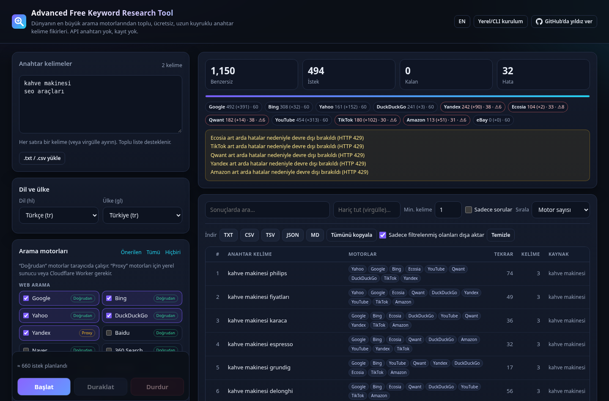

<div align="center">


# Advanced Free Keyword Research Tool

**25 arama motorunun otomatik tamamlama önerilerinden toplu, uzun kuyruklu anahtar kelime fikirleri — ücretsiz, açık kaynak, API anahtarı yok.**

Google · Bing · YouTube · Yahoo · DuckDuckGo · Yandex · Baidu · Naver · Amazon · eBay · Walmart · TikTok · Wikipedia · Ecosia · Qwant · Brave · Seznam · 360 · Sogou · Quark · Swisscows · Google Görseller / Haberler / Alışveriş / Akademik

[**▶ Web uygulamasını aç**](https://cumabozkurt.github.io/advanced-free-keyword-research-tool/) · [English](README.md) · [Araştırma](RESEARCH.md) · [Uç noktalar](docs/ENDPOINTS.md) · [Denetim](docs/AUDIT.md)



</div>

## Özellikler

- **25 arama motoru** (14'ü GitHub Pages üzerinde doğrudan tarayıcıda, 25'inin tamamı CLI / yerel sunucu / GitHub Action ile)
- **Toplu giriş** — yüzlerce kelimeyi yapıştırın veya `.txt` / `.csv` yükleyin
- **Uzun kuyruk genişletme** — alfabe sonek/önek (dile duyarlı: Türkçe `ç ğ ı ö ş ü` dahil), rakamlar, soru kalıpları (`nasıl, nedir, neden…`), niteleyiciler (`için, en iyi, fiyatları, yakınımda…`), kendi önek/sonekleriniz
- **Özyinelemeli tarama** — derinlik kontrolü; yeni öneriler seçili *tüm* motorlarda tekrar sorgulanır
- **Tekilleştirilmiş sonuçlar** — *motor uyumu* puanı (kaç motor aynı ifadeyi önerdi), tekrar sayısı, kelime sayısı, soru işareti, kaynak kelime
- **Filtrele & sırala** — arama, hariç tutulan kelimeler, minimum kelime, sadece sorular
- **Dışa aktarma** — TXT, CSV (Excel için UTF-8 BOM, formül enjeksiyonuna karşı korumalı), TSV, JSON, Markdown, panoya kopyala
- **Nazik tasarım** — motor başına bekleme, paralellik sınırı, en fazla istek sayısı, duraklat / devam / durdur, hata veren motoru otomatik kapatma
- **Google sonuç sayfası (SERP) taraması** — isteğe bağlı olarak her kelime için Google sonuç sayfalarını 1…100 arası gezer; *ilgili aramaları*, *Diğer kullanıcılar şunları da sordu* sorularını ve (isteğe bağlı) organik başlıkları toplar; CAPTCHA'da kibarca durur — bkz. [Google sonuç sayfaları](#google-sonuç-sayfaları-serp)
- **Arama dili ve ülkesi** (varsayılan 🇹🇷 `tr` / `tr`) destekleyen her motora iletilir — bkz. [Dil ve ülke](#dil-ve-ülke)
- **Türkçe & İngilizce arayüz**, koyu tema, klavye erişilebilir, mobil uyumlu, ayarlar tarayıcıda saklanır
- **Çalışma zamanı bağımlılığı yok, derleme yok** — tarayıcı ve Node aynı ES modüllerini kullanır (isteğe bağlı SERP tarayıcı arka ucu `puppeteer-core` kullanır)

## Kullanım yolları

### 1. Tarayıcıda (GitHub Pages)

**https://cumabozkurt.github.io/advanced-free-keyword-research-tool/** adresini açın, kelimeleri yazın, motorları seçin, **Başlat**'a basın.
**Doğrudan** etiketli motorlar hemen çalışır. **Proxy** etiketliler (Amazon, Yandex, Brave, Ecosia, Qwant, Walmart, TikTok…) için 2. veya 5. seçeneğe bakın.

Paylaşılabilir bağlantı: `…/?q=seo+araçları&engines=google,bing,youtube&hl=tr&gl=tr&run=1`

### 2. Yerel sunucu — tarayıcıda tüm motorlar

```bash
git clone https://github.com/cumabozkurt/advanced-free-keyword-research-tool
cd advanced-free-keyword-research-tool
npm start            # → http://localhost:8787  (Node 18+, kurulacak bir şey yok)
# isteğe bağlı, Google sonuç sayfası taraması için:  npm install  (sonra yeniden başlatın)
```

Uygulama yerleşik proxy'yi otomatik algılar ve tüm motorları açar.

### 3. Komut satırı (CLI)

```bash
node bin/cli.js "seo araçları"                                # varsayılan: Türkçe / Türkiye
node bin/cli.js "seo tools" -l en -c us                       # İngilizce / ABD
node bin/cli.js -f kelimeler.txt -e all -x alpha,questions -d 1 -o sonuc.csv -o sonuc.txt
node bin/cli.js "kahve makinesi" -e google,yandex,amazon,youtube -o kahve.json   # amazon.com.tr
cat kelimeler.txt | node bin/cli.js -e web -x none --format tsv > sonuc.tsv
node bin/cli.js --list-engines
node bin/cli.js --help
```

### 4. Doğrudan GitHub üzerinde — bilgisayar gerekmez

Repoyu fork'layın → **Actions** → **Mine keywords** → **Run workflow**, kelimeleri ve motorları girin → `keywords` artifact'ını indirin (TXT/CSV/TSV/JSON).
İlk 100 sonuç çalışma özetinde görünür. Bu yöntemde tüm motorlar çalışır (sunucu tarafı olduğu için CORS sorunu yok).

### 5. Pages sitesi için kendi proxy'niz (isteğe bağlı)

```bash
cd proxy && npx wrangler deploy      # Cloudflare Workers ücretsiz katman
```

Worker adresini uygulamada **Seçenekler → Proxy URL** alanına yapıştırın. `proxy/wrangler.toml` içinde `ALLOWED_ORIGINS` değerini Pages adresiniz yapın.

Pages uygulamasını **yerel** sunucunuza da bağlayabilirsiniz (`http://localhost:8787`). Yerel sunucu varsayılan olarak yalnızca
`https://cumabozkurt.github.io` kaynağından gelen çağrılara izin verir; fork için `npm start -- --allow-origin https://<siz>.github.io`.

## Dil ve ülke

Öneriler pazara göre çok değişir; bu yüzden her aramanın arayüz dilinden bağımsız bir **arama dili** (`hl`) ve **ülke/bölgesi** (`gl`) vardır.
Varsayılan: **Türkçe / Türkiye** (`tr` / `tr`).

- **Web uygulaması:** *Arama dili ve ülkesi* kartı — ~38 dil, ~60 ülke ve hızlı ön ayarlar (TR, US, UK, DE, FR, AZ, SA). Canlı bilgi satırı, seçili motorlardan hangilerinin dil/ülkeyi kullandığını ve nereye gittiğini gösterir (ör. `Amazon → amazon.com.tr`). `?hl=tr&gl=tr` ile paylaşılabilir.
- **CLI:** `-l/--lang <hl>` ve `-c/--country <gl>` (ISO kodları doğrulanır). `--list-engines` her motorun dil/ülke desteğini gösterir.
- **GitHub Action:** `lang` / `country` girdileri (varsayılan `tr` / `tr`).
- Genişletme alfabesi ve soru kalıpları arama diline göre seçilir (Türkçe `ç ğ ı ö ş ü`, Azerice `ə`, Lehçe, Ukraynaca, Rusça, Almanca, İspanyolca…).

| Motor | `hl` / `gl` neyi belirler |
|---|---|
| Google, YouTube, Görseller, Haberler, Alışveriş | `hl` + `gl` |
| Google Scholar | `hl` |
| Bing | pazar `mkt={hl}-{GL}` |
| DuckDuckGo | bölge `kl={gl}-{hl}` |
| Yahoo | 19 ülke için bölgesel sunucu; diğerleri (TR dahil — TR uç noktası boş döner) → ABD |
| Yandex | `uil={hl}` + bölge `lr` (tr, ru, ua, by, kz, uz, az, us, de, gb, fr) |
| Ecosia `mkt` · Qwant `locale` · Swisscows `locale` · Brave `country` · TikTok `region`+`language` | dil/ülke |
| Amazon | ülkeye göre pazaryeri: us, gb, de, fr, it, es, **tr**, jp, ca, in, br, mx, au, nl (diğerleri → amazon.com) |
| eBay | ülkeye göre site (diğerleri → ebay.com) |
| Wikipedia | `{hl}.wikipedia.org` |
| Baidu, 360, Sogou, Quark (CN) · Naver (KR) · Seznam (CZ) · Walmart (US) | tek pazar — dil/ülke yok sayılır |

## Google sonuç sayfaları (SERP)

Otomatik tamamlama yalnızca insanların *yazdığını* gösterir. Google sonuç sayfaları buna **ilgili aramaları** ("İlgili aramalar" /
"Searches related to"), **Diğer kullanıcılar şunları da sordu (PAA)** sorularını ve sonuç başlıklarını ekler. Bu seçenek açıldığında araç
her kelime için `start=0,10,20…` sonuç sayfalarını sırayla açar (1–100 sayfa, varsayılan 10), yalnızca bu anahtar kelime alanlarını çıkarır
(HTML saklanmaz/gösterilmez), kaynağa göre etiketler (`serp-related`, `serp-paa`, `serp-organic`) ve aynı tekilleştirilmiş sonuçlara ve
dışa aktarımlara ekler. Otomatik tamamlama motorları paralel olarak çalışmaya devam eder.

**Nerede çalışır:** Yalnızca CLI ve yerel sunucu (bir kez `npm install`, sonra `npm start` veya CLI). Statik GitHub Pages sitesi Google
sonuç sayfalarını okuyamaz (CORS + Google JavaScript ister); Pages uygulamasını yerel sunucunuza yönlendirirseniz o da kullanabilir.
GitHub Action'da `serp_pages` girdisi var, ancak GitHub sunucu IP'leri neredeyse her zaman CAPTCHA ile engellenir.

```bash
npm install                                     # isteğe bağlı puppeteer-core (SİZİN kurulu Chrome/Chromium/Edge tarayıcınızı kullanır)
node bin/cli.js "kahve makinesi" --serp                       # otomatik tamamlama + 10 Google sayfası, ilgili + PAA
node bin/cli.js "kahve makinesi" --serp-only --serp-pages 30 --serp-sources related,paa,organic -o kahve.csv
npm start                                       # web uygulaması: "Google arama sayfalarını tara" kutusunu işaretleyin (1–100 sayfa)
```

| CLI seçeneği | Anlamı |
|---|---|
| `--serp` | otomatik tamamlamaya ek olarak SERP sayfalarını tara |
| `--serp-only` | yalnızca SERP sayfaları, otomatik tamamlama yok |
| `--serp-pages <1-100>` | kelime başına sayfa (varsayılan 10) |
| `--serp-sources related,paa,organic` | toplanacaklar (varsayılan `related,paa`) |
| `--serp-delay <ms>` | sayfa yüklemeleri arası bekleme, en az 2000 (varsayılan 5000) |
| `--serp-backend browser\|html` | `browser` = puppeteer-core ile yerel Chrome (varsayılan); `html` = düz HTTP (Google şu an JavaScript duvarı gösteriyor) |
| `--serp-headful`, `--serp-chrome <yol>`, `--serp-profile <klasör>` | tarayıcı penceresini göster, tarayıcı dosyasını seç (veya `CHROME_PATH`), profili yeniden kullan (çerez onayı seçiminiz kalır) |

Sunucu seçenekleri: `--no-serp`, `--serp-backend`, `--serp-headful`, `--serp-chrome`, `--serp-profile`, `--serp-gap <ms>` (Google sayfa yüklemeleri arası en az süre, varsayılan 4000).
`/api/serp` yalnızca yerel sunucunun loopback istemcilerine yanıt verir (aynı köken veya `--allow-origin`), yalnızca ayrıştırılmış alanları döndürür,
sayfa yüklemelerini sıraya koyar, sonuçları 6 saat önbellekte tutar ve CAPTCHA'dan sonra 15 dakika boyunca Google'a yeni istek göndermez.
Dil ve ülke seçimleri `hl`, `gl` ve `lr=lang_{hl}` (artı `pws=0`) olarak gönderilir.

**Gözlemlediğimiz sınırlar (Ekim 2026) — lütfen okuyun:**

- Google **sayfa başına 10 sonuç** verir (`num=` artık dikkate alınmıyor); 100 sayfa = en fazla ~1000 sonuç. Pratikte Google çoğu zaman
  birkaç ila birkaç düzine sayfadan sonra "Sonraki" bağlantısını kaldırır — araç o kelime için durur.
- Düz HTTP istemcileri (curl, Node `fetch`, metin tarayıcılar) sonuç yerine **"JavaScript'i etkinleştirin" duvarı** alır.
- **Veri merkezi / bulut / CI IP'lerinden** gerçek headless Chrome, **"sıra dışı trafik" CAPTCHA'sı** (`/sorry/`) alır — test sunucumuzda daha
  ilk sayfada. Normal ev/ofis bağlantısında, az sayfa ve uzun beklemeyle sonuçlar çok daha iyidir.
- İlgili aramalar ve PAA blokları her sorguda/sayfada gösterilmez; organik başlıklar anahtar kelime olarak gürültülüdür (varsayılan kapalı).
- Google'ın resmî Custom Search JSON API'si yeni müşterilere kapalı ve 1 Ocak 2027'de kapanıyor, bu yüzden sunulmuyor.

**CAPTCHA, çerez onayı veya JavaScript duvarında SERP aşaması hemen durur** ve nedenini bildirir; otomatik tamamlama devam eder.
Bilinçli olarak **CAPTCHA çözme, proxy rotasyonu, gizlenme / parmak izi sahteciliği yoktur** — bunlar bot korumasını atlatmadır ve kapsam dışıdır.

> ⚠️ **Kullanım Şartları:** Google Hizmet Şartları, arama sonuç sayfalarının otomatik olarak sorgulanmasına izin vermez.
> Bu özellik kişisel araştırma için sıradan bir tarayıcıyı yavaş tempoda kullanır; yine de kullanım **sizin sorumluluğunuzdadır**
> (tipik sonuç IP'nizin geçici olarak engellenmesidir). Az sayfa kullanın, beklemeleri koruyun; hacim için otomatik tamamlama motorlarını tercih edin.

## Motorlar

| | Motorlar |
|---|---|
| **Tarayıcıda doğrudan** (JSONP / CORS) | Google, YouTube, Google Görseller, Google Haberler, Google Alışveriş, Bing, Yahoo, DuckDuckGo, Baidu, 360 Search, Naver, Seznam, eBay, Wikipedia |
| **Proxy / CLI ile** | Yandex, Amazon (14 pazaryeri), Walmart, Ecosia, Qwant, Swisscows, Sogou, Quark, Google Scholar, TikTok\*, Brave\* |

\* deneysel. Tüm uç nokta belgeleri: [docs/ENDPOINTS.md](docs/ENDPOINTS.md). Sağlık kontrolü: `npm run check`.

## Mimari

Aynı `web/js/engines.js` (motor kayıtları) ve `web/js/miner.js` (kuyruk, hız sınırı, özyineleme, tekilleştirme) tarayıcıda, CLI'da, yerel sunucuda ve Cloudflare Worker'da çalışır. Ayrıntılar için [README.md](README.md#architecture).

## Geliştirme

```bash
npm test        # 45 test: ayrıştırıcılar, dil/ülke, kuyruk, dışa aktarma, proxy, CLI, sunucu, SERP (gerçek CAPTCHA sayfası dahil HTML örnekleri, sahte Google uçtan uca)
npm run check   # canlı uç nokta kontrolü
npm start       # yerel sunucu
```

Yeni motor eklemek = `web/js/engines.js` içine bir nesne (+ bir ayrıştırıcı testi). Bkz. [CONTRIBUTING.md](CONTRIBUTING.md).

## Güvenlik notları

- Web uygulaması katı bir **Content-Security-Policy** kullanır: betikler yalnızca uygulamanın kendisinden ve sabit JSONP motor sunucularından yüklenir.
- Tüm motor çıktıları `textContent` ile gösterilir (HTML enjeksiyonu yok). CSV dışa aktarımı formül enjeksiyonuna karşı korumalıdır.
- Proxy (yerel sunucu / Worker) **açık proxy değildir**: motorlar izin listesindedir, hedef URL sunucuda oluşturulur, `hl`/`gl` doğrulanır,
  sorgu uzunluğu ve yanıt boyutu (2 MB) sınırlıdır, IP başına hız sınırı ve önbellek vardır.
- Yerel sunucu varsayılan olarak `127.0.0.1` adresini dinler ve yalnızca izin verilen kaynaklara CORS açar (`--allow-origin`).
- `/api/serp` yalnızca loopback istemcilere yanıt verir (yabancı `Origin` → 403), ham HTML döndürmez ve `--serp-profile` verilmedikçe temiz bir tarayıcı profili kullanır.

## Sorumlu kullanım

Bu araç **herkese açık otomatik tamamlama uç noktalarını** düşük hızda okur — bir tarayıcının arama kutusunun yaptığı isteklerle aynı.
Varsayılan bekleme sürelerini koruyun, servisleri yormayın ve her sağlayıcının kullanım koşullarına uyun. Captcha veya bot korumasını aşmaz.
İsteğe bağlı Google SERP modu sonuç sayfalarını okur; Google'ın şartları otomatik istemcilere buna izin vermez — [yukarıdaki uyarıya](#google-sonuç-sayfaları-serp) bakın.
Uç noktalar resmî değildir ve her an değişebilir.

## Teşekkür & lisans

[keywordshitter2](https://github.com/wassname/keywordshitter2) (wassname) ve orijinal keywordshitter'dan esinlenilmiştir.
Motor listesi [SearXNG](https://github.com/searxng/searxng) ile karşılaştırılmıştır.

MIT © Cuma Bozkurt
